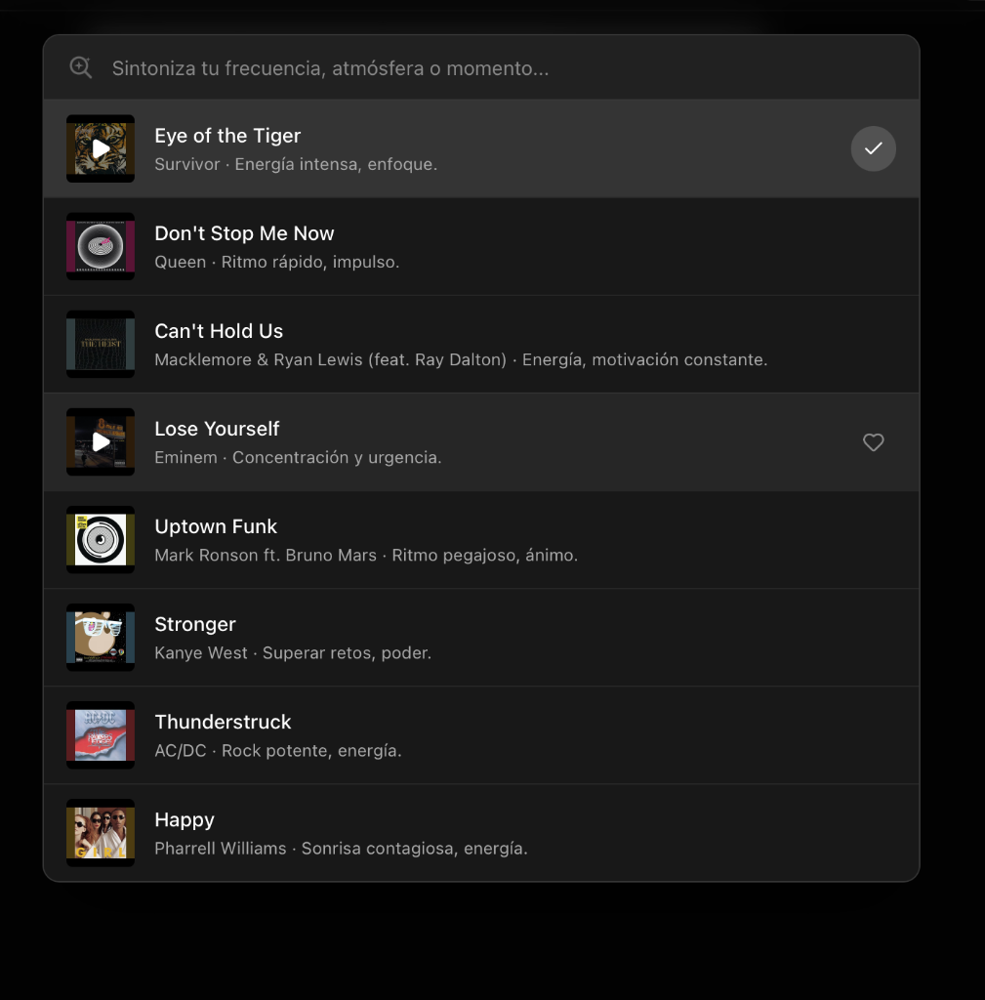

<div align="center">
  
  <h1>Aura</h1>
  <p><strong>Native macOS Music Experience with Apple Spatial Audio, Semantic AI Search & Cross-Platform Library Importer</strong></p>

  <p>
    
    
    
    
    
  </p>
</div>

---

## Overview

**Aura** is an ultra-lightweight (**2.0 MB**) native macOS application built on **Swift + Safari `WKWebView` (`AVFoundation`)** and **React + TypeScript**.

Unlike Chromium/Electron wrappers that consume hundreds of megabytes of RAM and block Apple's native audio pipeline, Aura runs directly on macOS's native WebKit engine—unlocking **Apple Spatial Audio (*Spatialize Stereo* + Dynamic Head Tracking with AirPods Pro/Max)** in macOS Control Center while keeping 100% original audio and video quality.

---

## Key Features

### 1. Native Apple Spatial Audio (`WKWebView` + `AVFoundation`)
- Full support for **Spatialize Stereo** (*Fixed* and *Head Tracked*) in macOS Control Center with AirPods Pro, AirPods Max, and AirPods (3rd/4th Gen).
- **100% Untouched Audio & Video Quality:** Streams at original default quality without downsampling or transcoding.
- **Background Eco-Mode:** Automatically pauses decorative CSS transitions when the window is unfocused, reducing GPU/CPU usage to near zero while keeping background playback pristine.

### 2. Semantic AI Music Search (`Aura AI`)
- Describe what you are doing, your mood, or your environment (e.g., *"I'm coding late at night and need motivating music"*).
- Instead of performing a literal keyword search, Aura reasons about tracks that match the vibe, resolves their official YouTube Music `videoId` and artwork in parallel, and plays any track on click.
- **Works Out-of-the-Box (Keyless Default) + Optional Gemini 2.5 Flash API Key:** Works immediately with zero configuration, or optionally connect your own free-tier Google Gemini API Key in Settings.

<div align="center">
  
</div>

### 3. Spotify & Apple Music Library Importer
- **Spotify (OAuth 2.0 PKCE + GraphQL Pagination):** Connect your Spotify account to import all your **Liked Songs** (full pagination across 1,000+ tracks) and **User-Created / Saved Playlists** directly into your YouTube Music Likes or Playlists.
- **Apple Music (Native macOS `Music.app` Bridge):** Reads your local macOS `Music.app` library, Favorite Songs, and Playlists in `< 0.1s` via batch JXA (`osascript`) with zero paid developer tokens required.
- **Public Playlist URL Parser:** Paste any public Spotify playlist link to preview and transfer tracks.

### 4. Real-Time Web Audio Equalizer & Dynamic Artwork Theme
- **3-Band Web Audio Equalizer:** Switch in real time between *Original (Flat)*, *Bass Boost*, *Vocal Clarity*, and *Warm Studio*.
- **Dynamic Player Accent Color:** Automatically samples the dominant vibrant color from the currently playing song's artwork (or choose between *Aura Violet*, *Emerald*, *Cyan*, *Coral*, and *YT Red*).
- **Multi-Language (`i18n`):** Defaults to **English (`en`)** and automatically adapts to your macOS system language (**English** / **Spanish**), with a manual language switcher in Settings.

---

## Architecture

Aura follows **Clean Architecture** and modular separation of concerns across both the native macOS Swift layer and the React/TypeScript UI layer:

```text
Aura/
├── macos/
│   ├── Info.plist                              # Bundle metadata, Bluetooth & AppleEvents permissions
│   ├── build-safari-release.sh                 # Native arm64 compiler & DMG packager
│   └── Sources/
│       ├── App/
│       │   ├── main.swift                      # Native AppKit entry point
│       │   └── AppDelegate.swift               # App lifecycle & localized native menu bar
│       ├── Core/
│       │   ├── AppConfig.swift                 # Constants, paths & system locale detection
│       │   └── CryptoUtils.swift               # SHA-1 (SAPISIDHASH) & OAuth 2.0 PKCE S256
│       ├── WebEngine/
│       │   ├── AuraSchemeHandler.swift         # Zero-port custom scheme handler (aura://app)
│       │   └── YouTubeEnhancerScripts.swift    # Static Aura branding, ad-skipper & JS bridge
│       ├── Services/
│       │   ├── GoogleAuthService.swift         # Cookie store sync & SAPISIDHASH authentication
│       │   ├── SpotifyService.swift            # Spotify OAuth 2.0 PKCE & Pathfinder GraphQL client
│       │   ├── AppleMusicService.swift         # Native macOS Music.app JXA batch reader
│       │   ├── YouTubeMusicService.swift       # InnerTube track matcher & instant SPA playback
│       │   └── AISearchService.swift           # Semantic AI curator (Keyless default + Gemini 2.5)
│       └── UI/
│           └── MainWindowController.swift      # Dual WKWebView compositor, Mini-Player & media keys
├── src/
│   ├── i18n/
│   │   └── index.tsx                           # System-aware i18n provider (EN default / ES auto)
│   ├── components/
│   │   ├── TopBar/
│   │   │   ├── TopNavigationBar.tsx            # Window-draggable navigation bar
│   │   │   └── SettingsPopover.tsx             # Theme, EQ, Gemini API key, language & importer
│   │   ├── AISearch/
│   │   │   ├── AISearchIcon.tsx                # Custom AI magnifying glass vector SVG
│   │   │   └── AISearchModal.tsx               # Native YouTube Music-styled AI search modal
│   │   └── Importer/
│   │       ├── MusicImporterModal.tsx          # Multi-source importer orchestrator
│   │       ├── SpotifyLibraryView.tsx          # Spotify Liked Songs & Playlists view
│   │       ├── AppleMusicLibraryView.tsx       # macOS Music.app library & Playlists view
│   │       ├── SpotifyUrlImporterView.tsx      # Public playlist link extractor
│   │       └── TransferProgressView.tsx        # Real-time track matching & transfer log
│   ├── services/
│   │   └── ytmBridgeService.ts                 # 3-band BiquadFilter EQ & InnerTube mutations
│   ├── types/
│   │   └── index.ts                            # TypeScript domain contracts
│   ├── App.tsx                                 # Root application state & media key bindings
│   └── main.tsx                                # React root with I18nProvider
└── build/
    ├── icon.icns                               # macOS AppBundle icon
    └── icon.png                                # High-resolution Aura emblem
```

---

## Getting Started

### Prerequisites
- **macOS 13.0+** (Apple Silicon `arm64`)
- **Node.js 18+** & **Xcode Command Line Tools (`swiftc`)**

### Build & Install Native macOS Release (`.app` + `.dmg`)
```bash
# 1. Install frontend dependencies
npm install

# 2. Compile React bundle + Native Swift binary & package DMG
npm run dist:safari

# 3. Install to /Applications and launch
cp -R release/Aura.app /Applications/Aura.app
open -a /Applications/Aura.app
```

The installer image is generated at:
- `release/Aura-Safari-arm64.dmg` (~2.0 MB)
- `release/Aura.app` (~2.0 MB)

---

## Privacy & Local Storage

All user credentials, session cookies, and API keys are stored **strictly on your local machine** inside:
```text
~/Library/Application Support/Aura/
├── google-cookies.json       # Local YouTube Music session cookies
├── spotify-oauth-token.json  # Local Spotify OAuth PKCE token
└── aura-settings.json        # Optional user-provided Gemini API Key
```
None of these files are ever bundled into `Aura.app`, `Aura-Safari-arm64.dmg`, or committed to Git.

---

## Disclaimer

Aura is an independent open-source desktop application created for educational and personal use. It is not affiliated with, endorsed by, or sponsored by Google LLC, YouTube, Spotify AB, or Apple Inc. All trademarks and service marks belong to their respective owners.

---

## License

Released under the [MIT License](LICENSE).
